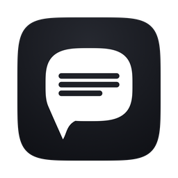
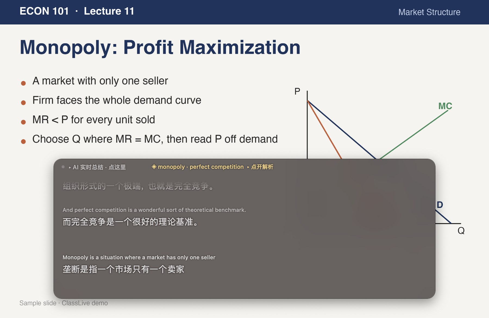
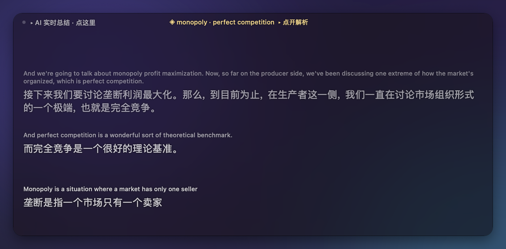
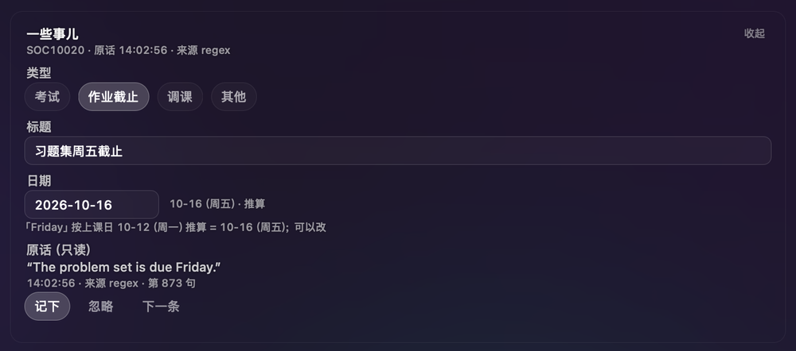
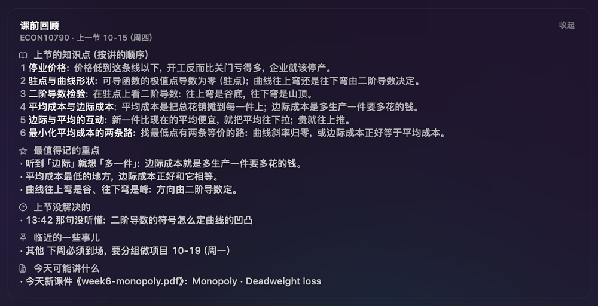
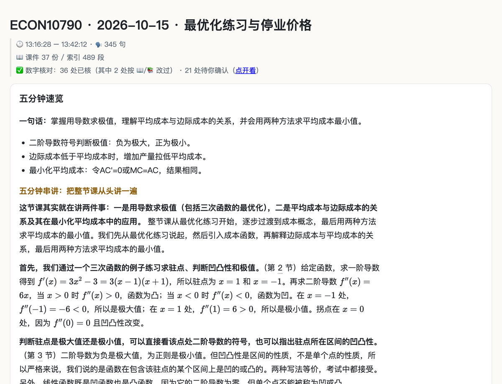
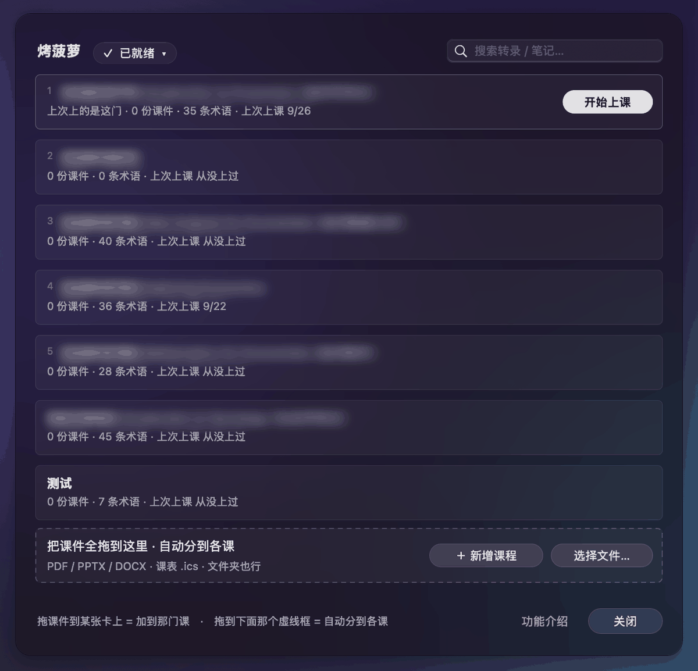
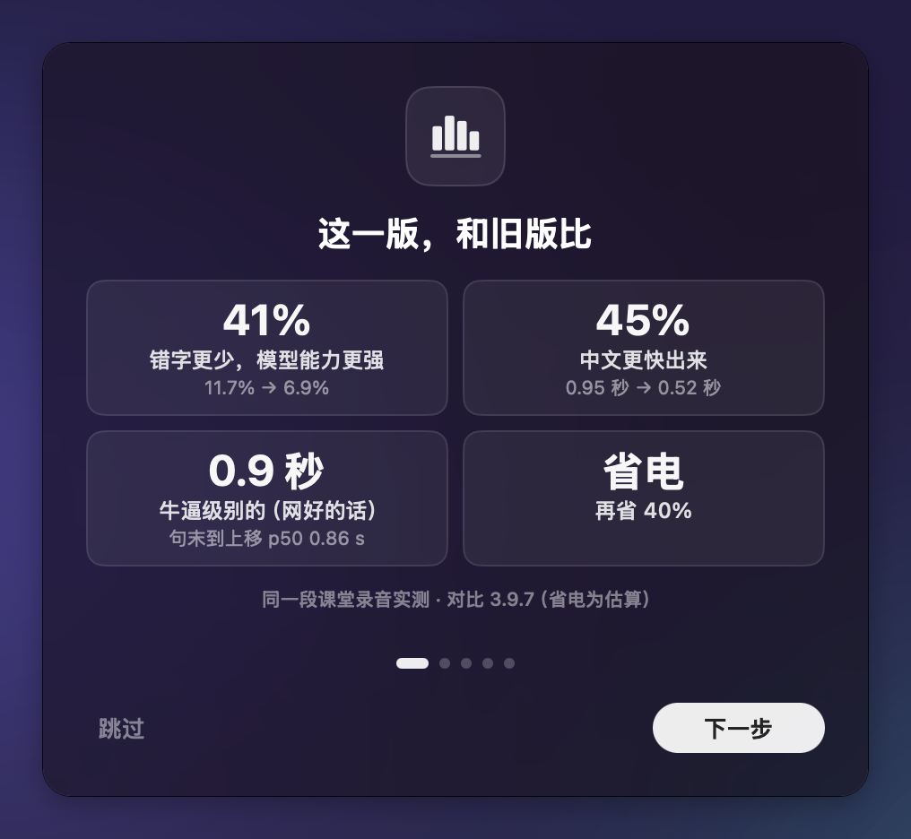
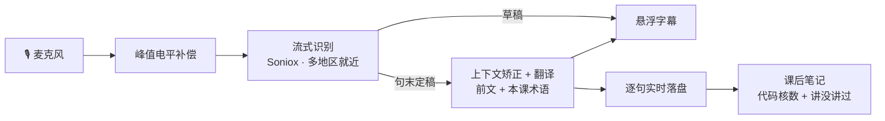

<div align="center">



# ClassLive

**英文课，实时看中文。**<br>
老师讲英文，屏幕上同步滚出中英双语字幕；下课自动出笔记。

[](https://github.com/OUENMING/lecture-live/releases/latest) [](#快速开始) [](LICENSE) [](https://github.com/OUENMING/lecture-live/stargazers)

[功能](#功能) · [实测](#实测数字) · [快速开始](#快速开始) · [常见问题](#常见问题) · [详细手册](docs/GUIDE.md) · [更新日志](CHANGELOG.md) · [隐私](#隐私)

</div>

> [!NOTE]
> **测试中。** 发邮件到 **enming.owen@outlook.com** 获取免费测试 key（通行码），填进去就能用，不用自己注册任何云服务。

<p align="center">
  
</p>

## 为什么做这个

留学第一年最难受的不是听不懂单词，而是**跟不上语速**：一句里两三个词没听清，整句就散了，你还在回想上一句，老师已经翻页了。

ClassLive 是跑在你自己 Mac 上的课堂字幕：

- **跟得上**：说完一句约 0.9 秒就定稿上移，中文首字 0.5 秒出来。
- **听得准**：前文和本课术语表一起给模型，`nation to` → `relation to` 这类听错会被修回来。
- **课后不用再整理**：重点、考试和截止日期、例题都自动整理好。

## 功能

### 🎧 实时双语字幕



- **英文在上、中文在下**，最底一行是正在听的那句，说完就定下来往上走。
- 老师一口气讲的几句接在同一行，停顿了才换行，字幕不乱跳。
- 窗口随便拉大，往回翻看整节课，新句子不会把你拽回底部。
- 右上角一键切三档：**双语 / 只英·校 / 纯转录**。

### 💬 没听懂，当场问

- 按「讲一下」，AI 就着这节课到目前为止的转录，把刚才那段讲给你听。
- 底部输入框直接打字追问；问过的问题课后自动变成复习卡。
- 左上角「AI 实时总结」：边听边分小节、提炼要点，走神回来点开就知道讲到哪了。
- 冒出 `endogeneity` 这类术语时，顶栏出一行提示，点一下看解释。

### 📌 一些事儿 · 课前回顾

<table>
<tr>
<td width="50%"></td>
<td width="50%"></td>
</tr>
<tr>
<td align="center">老师随口说的考试、截止、调课 → 一键进提醒事项</td>
<td align="center">开课前看上节讲到哪、哪里没听懂</td>
</tr>
</table>

### 📝 课后笔记，数字由代码核



- 一份 Obsidian 精简版 + 一份离线可用的交互网页详细版（例题、补全题、三档自测、Anki 卡片）。
- **笔记里的数字由代码算**：求导、求极值、代入都由程序执行，讲解里的每个数要对得上，对不上的例题直接撤掉。
- 逐句核「课上真讲过吗」：AI 自己补的内容会单独标出来，不冒充老师原话。

### 🗂 一门课一张卡



- 课件（PDF / PPTX / DOCX / 课表 .ics）拖进来，自动分到各门课、抽出术语。
- 回车直接开始这会儿课表上的那门课。
- 顶上的搜索框能搜所有课的转录和笔记。

## 实测数字



同一段公开课录音，3.10.0 对比 3.9.7：

| | 3.9.7 | 3.10.0 |
|---|---|---|
| 错字率（WER） | 11.7% | **6.9%**（少 41%） |
| 中文首字 | 0.95 秒 | **0.52 秒**（快 45%） |
| 说完到定稿上移（p50） | | **0.86 秒** |
| 耗电 | | 约省 40%（估算） |

一节 2 小时的课，用自己的 DeepSeek key 翻译约 **$0.2–0.4**；「纯转录」档不发任何翻译请求，翻译费为 0。

<br clear="right">

## 技术亮点



| 做法 | 做到了什么 / 实测 |
|---|---|
| **双轨字幕：先快后准，字不乱跳** | 草稿边说边出；句末标点在流式结果里稳住 0.3 秒才封口定稿，原地升级，不另起一行。错字率 **6.9%**，说完到定稿 p50 **0.86 秒**，误定稿 **1.1%** |
| **中文不断流** | 数「相对上次送翻的新词」而不是「比上次多几个词」，再加防饥饿兜底：一段课的回放里，老师讲着话、却超过 6 秒没有新中文的累计时长 **398 秒 → 约 20 秒** |
| **按老师的停顿换行** | 用识别给出的句间端点判断接不接：一口气讲的几句接在同一行；只英档同一段回放上滚 **82 → 46 次** |
| **中文按词组折行** | 流式时贪心装箱，定稿时动态规划重折（词组边界用 BudouX）：折在词中间 **71 → 19 处**，只剩一个字的孤行 **33 → 0** |
| **这门课的词，课上现学** | 课上校正改对的词里 **89%** 不在任何术语表 → 从已定稿文本里现场捞本课术语喂给翻译；五道门挡住「反复听错的词」（实测 votes→boats 一节课错 11 次，不能被当成术语） |
| **上下文矫正** | 前文 + 本课术语表一起给模型：核心词常驻 + 按句动态召回；前文按块对齐命中前缀缓存，翻译输入成本约 **−40%** |
| **远场补电平，不做降噪** | 实测后排的问题是声音小、不是噪声多：补电平后可用动态范围 **+24 dB**；降噪实测词数 **−41%**，所以不做 |
| **笔记里的数字由代码算** | 求导、求极值、代入由程序执行；化学方程式核元素和电荷守恒；对不上的例题撤掉。每次改动都要过 **12 段真实转录 + 48 条**冻结判据 |
| **老师口误，笔记以更正为准** | 抽出「sorry / I mean / X not Y」这类当场更正，再用多项式代数互核：老师把 −12Q 口误、11 秒后改成 −24Q，笔记只认 −24Q |
| **碎句先并再译** | 12 秒切段会把一句话劈成两行（真课 20–28% 的定稿没有句末标点）；笔记里先并成整句再译，盲评意思 / 通顺 **4.12 / 3.44 → 4.46 / 4.34**（120 对） |
| **字幕排版有出处，不靠拍脑袋** | 英文在上、中文在下，依据三篇同行评审的双语字幕研究；两行滚动、新字只进最底行，照美国字幕法规 47 CFR §15.119 和广电字幕规范，实测两行能覆盖 94.2% 的画面 |
| **在「后排教室」里调参** | 自建 24 份带真值的模拟课堂录音：大阶梯教室 / 小班 × 前中后排 × 4 档噪声（咳嗽、翻书、挪椅子），改识别和收音前都先拿它量 |

每个数字都来自实测：怎么量的写在 [CHANGELOG](CHANGELOG.md)，可复跑的实验在 [`docs/experiments/`](docs/experiments/)。

## 快速开始

需要 **macOS 13+ 和 Apple Silicon（M1 及以后）**，先装 [`uv`](https://docs.astral.sh/uv/)。

```bash
git clone https://github.com/OUENMING/lecture-live.git
cd lecture-live
./install.sh        # 构建并装进「应用程序」，自带 Python 和全部依赖，要几分钟
```

1. 双击 **ClassLive.app**，允许麦克风。
2. 就绪条上点「翻译引擎」，填测试 key（见开头）或自己的 DeepSeek key。
3. 点一门课的「开始上课」。

之后有新版本会在后台自动更新。命令行用法、线上课收系统声、术语表、全部参数见 [详细手册](docs/GUIDE.md)。

## 常见问题

<details>
<summary><b>Windows / Intel Mac 能用吗？</b></summary>

不能。本地推理依赖 Apple Silicon 的 MLX，悬浮窗用的是 macOS 原生界面（AppKit）。

</details>

<details>
<summary><b>坐后排、老师离得远，能收到吗？</b></summary>

能。远场的主要问题是声音太小，不是噪声太多，所以 ClassLive 先补电平再识别，实测能用的动态范围扩大约 24 dB。降噪实测是负收益（词数 −41%），所以不做。依据见 [详细手册 · 为什么不做降噪](docs/GUIDE.md#为什么不做降噪--人声分离--频段滤波)。

</details>

<details>
<summary><b>线上课（Zoom / Teams）能用吗？</b></summary>

能。装一个 Multi-Output Device，把系统声同时送到扬声器和 BlackHole，然后 `cl online`。

</details>

<details>
<summary><b>断网了会怎样？</b></summary>

英文字幕不会断：云端识别不可用时退回本地识别。翻译失败时，装了本地兜底模型（可选，938 MB，`cl doctor` 里装）就降级到本地翻译，每 90 秒探测一次，云端恢复后自动切回；没装就只出英文。

</details>

## 贡献

欢迎 Issue 和 PR。这个项目的结论都来自实测，所以：性能相关的改动请附**真实负载**下的测量，注释里的数字必须来自测量。设计依据从 [`docs/README.md`](docs/README.md) 进。

## 隐私

- **正常上课不录音**，只把音频流拿去转写；只有你主动开「测试模式」才会录。
- 开了「测试模式」，收尾会把这节课的音频、转录、笔记和诊断日志自动上传给作者，用来排查问题和改进识别（`CLASSLIVE_UPLOAD=0` 关）。
- 不想让音频出本机：在开课面板「语音模型」里取消勾选「云端转写」，或用 `CLASSLIVE_CLOUD_ASR=0` 启动。
- 翻译只发文本；字幕、转录和笔记都存在你自己电脑上。

<details>
<summary>音频和文本具体发给谁</summary>

🔒 **隐私（3.10.0 起）**：云端转写默认开，音频会发给三家：① **Soniox**（实时字幕，用通行码时）—— 整节课的音频**直连** Soniox（按你所在地区走美国 / 欧盟 / 日本节点；作者的服务器只发一把临时 key，不经手音频），同时发**本课课名和术语表**帮它认准专有名词；按 Soniox 政策，实时请求只在处理时经手、不存储、不用于训练（[Security and privacy](https://soniox.com/docs/stt/security-and-privacy)，2026-10-18 读）；② **Groq**（美国；定稿时每段音频，Opus 压缩约 65 KB/段，经作者的服务器转发；默认不留存，滥用监控最长 30 天）；③ 阿里云百炼国际站（新加坡；Groq 不可用时的备用；不用于训练，调用数据默认最长保留 30 天）。要保证音频不出本机：在开课面板上点「语音模型」，取消勾选「云端转写」，或用 `CLASSLIVE_CLOUD_ASR=0` 启动。只切到「纯转录」档**不够**——每节课都从翻译档开始，切换之前的几段已经发出去了。

**文本会发给谁**：默认只有 **DeepSeek**（翻译、复习层、实时总结；课后精修**默认关**，开了也只是同一个收件方）。填的是作者给的**通行码**（`cl-` 开头，3.9.2 起）时，这些文本先经**作者的服务器**再转给 DeepSeek（作者付费）；服务器只记用量数字（每天的转写秒数、请求数、token 数，以及用过这个码的设备匿名安装号和首末次时间；另外每个请求记一条：用的模型、耗时、状态码、客户端版本号、所在国家，保留 3 个月），不记文本、音频和 IP。**音频**则默认发给云端转写（Soniox 直连；Groq / 阿里云百炼经作者的服务器；见上面的隐私说明，可关）。「重点句」+「课务」两个功能要给整节课的转录逐批打分：用**通行码**时（3.9.4 起）由作者代付，转录经**作者的服务器**转给 **TypeSafe 官方**（服务器同样只记次数，不记文本）；自己配了 **Jev key** 时直接发给 **TypeSafe 官方** 或 **CommandCode**（按你的 key 是哪家的，只发一家），不经作者的服务器。用自己的 DeepSeek key、又没配 Jev key —— 那两个功能不出现，也就没有第二个收件方。

</details>

## License

[MIT](LICENSE) © 2026 OUENMING

## Star History

[](https://star-history.com/#OUENMING/lecture-live&Date)
