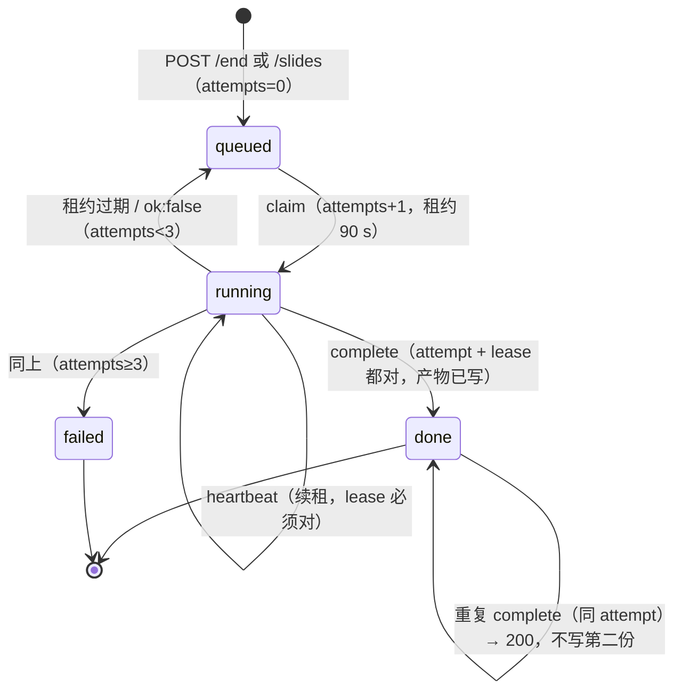

# 网页版服务端接口 v0（样例，给 Owen 确认）

2026-11-17 · **只有文档，没有实现**。依据：`docs/TASKS-web-cloud-20261114.md`（P4 表，本文 §3/§4 逐条对应）、
`docs/PLAN-web-cloud-20261114.md`（P4 §5、Q2:97 / Q4b:111 / Q5:100 / Q8:112）、`docs/RESEARCH-web-cloud-20261114.md`（E6/E7/C9/B2/B4）。
行号取自本 worktree（分支 `web-scaffold`）。**查不到出处的一律写「未核」**，不写成结论。

要 Owen 点头的三处：§7 的数值、§4.4 的两条增补路由、§8 第 1–4 条冲突点。

---

## 1. 现有 Worker 是什么样（摘要，带行号）

| 项 | 现状 | 位置 |
|---|---|---|
| 路由 | 只认四条 **POST**：`/v1/transcribe`、`/v1/chat/completions`、`/v1/jev`、`/v1/soniox/key`；其余（含任何 GET）一律 `404` **纯文本** `not found` | `server/asr-worker/src/handler.js:1076-1079` |
| 管理路由 | `POST /v1/admin/*` 在入口处短路（不进事件） | `handler.js:1053`（分发 `:842-848`） |
| 鉴权 | 通行码形状 `^cl-[a-z0-9]{1,16}-[0-9a-f]{16}$`；`Bearer cl-…` 走 PASSES DO 查码；否则比对 `Bearer ${env.CLIENT_TOKEN}`（公开令牌），secret 没配时 fail-closed；公开令牌只能调 `/v1/transcribe` | `passes-core.js:37`、`handler.js:1081-1095` |
| 码拒绝 | `unknown/revoked/expired/devices → 403`，`quota → 429`，DO 不可用 → `503 passes_unavailable` | `handler.js:437`、`handler.js:446-454` |
| 设备计数 | `x-classlive-install` 必须 32 位十六进制，否则 `400 bad install id`；新设备在 `max_devices` 名额内才登记，**额度先判、设备后记**；键是单个 `dev:<码>` | `handler.js:26,1095`、`passes-core.js:142-172` |
| 默认额度 | 设备 2 台、有效期 120 天、`daily_asr_s`/`daily_tokens`/`daily_rt_s` 全是 `null`（= 不限） | `passes-core.js:35-36,213-215` |
| 日用量 | 一格 `use:<UTC 日>:<码>`：`asr_s`/`tokens_in`/`tokens_out`/`rt_s`/`models`/`vers`/`mins`；只记数字 | `passes-core.js:6-14,174-206` |
| 实时转写记账 | 音频不经 Worker，`rt_s` 由 Cron 从 Soniox 用量日志事后回收（前排 3 h 重叠、uuid 去重）→ **日上限是软闸** | `passes-core.js:78-82,158-161`、`handler.js:1066-1071` |
| DO 用法 | 两个单实例 DO，`idFromName(名字)` 取 stub，只用 SQLite 后端（免费档）：`QUOTA`、`PASSES`；core 里不 import `cloudflare:*` | `server/asr-worker/wrangler.toml:50-66`、`handler.js:440-443`、`passes.js:1-11` |
| 限流 | Rate Limiting binding：`PER_INSTALL` 30 次/60 s、`PER_IP` 60 次/60 s；`429` + `retry-after: 60` | `server/asr-worker/wrangler.toml:68-84`、`handler.js:1110-1117` |
| 体积闸 | 先看 `Content-Length`（可能撒谎），再按**实际字节数**判；转写 512 KiB、对话 256 KiB、Jev 64 KiB；`413 too large` | `handler.js:25,418,424,1122-1126` |
| CORS | **一个 CORS 头都没有**（全仓 grep `access-control` 零命中）。桌面版是 Python，不需要 | — |
| R2 | 只在另一个 Worker（`server/upload-worker`）：单桶 `classlive-ingest`，前缀 `classlive-test/<hash16>/<name>`，**只有 PUT**（无读 / 列 / 删）；边读边计数 32 MiB；写失败回 502 | `server/upload-worker/src/index.js:13-19,45-95`、`server/upload-worker/wrangler.toml:28-30` |
| R2 生命周期 | Dashboard 不支持，`wrangler r2 bucket lifecycle add … --expire-days 180` 才行 | `server/upload-worker/wrangler.toml:26-28` |
| Soniox 临时 key | 发下去的是 `snx_temp_`（临时 key 接口），`single_use: true`、`max_session_duration_seconds` 默认 3 h（官方上限 5 h）、`client_reference_id` = 码名 | `soniox-core.js:25-27,82-88`、RESEARCH B2 |
| 测试写法 | `node --test test-*.mjs`；直接 `import` 真源码；上游一律假 `fetch`；DO 用 memory storage 替身（`get/put/delete/list`）+ 假时钟 | `test-passes.mjs:1-34`、`test-routes.mjs:1-22` |
| 现有测试钉着 | `GET → 404`、`POST /v1/other → 404`；`GET /v1/soniox/key → 404` | `test.mjs:108-109`、`test-soniox.mjs:129` |

---

## 2. 通用约定（v0 全部新接口）

```
Authorization: Bearer cl-<名字>-<16hex>      # 通行码（复用 CODE_RE，passes-core.js:37）
X-ClassLive-Install: <32 hex>                 # 同现有形状（否则 400）
X-ClassLive-Client: web                       # 新增：设备分账用；缺省 = desktop
Origin: https://<网页版子域>                  # 必须命中白名单，否则 403
```

- **错误体统一 JSON**：`{"error":"<稳定码>","detail":"<一句话，可选>"}`。现有四条老路由是纯文本 / 两种混写
  （`handler.js:1078` 纯文本、`handler.js:449,452` JSON），**老路由不改**，只有 `/v1/web/*`、`/v1/runner/*` 用 JSON。
- **稳定错误码**：`unauthorized`(401) · `forbidden`(403，Origin 不在白名单) · `unknown`/`revoked`/`expired`(403，
  码不能用，沿用 `handler.js:437`) · `devices`(403) · `quota_exceeded`(429) · `rate_limited`(429，带 `retry-after`)
  · `not_found`(404) · `session_ended`/`seq_too_far`/`stale_attempt`/`lease_mismatch`(409) · `session_deleted`(410)
  · `too_large`(413) · `bad_body`(400) · `upstream`(502/503)。
- **CORS**：只放行网页版那一个来源（E6，绝不用 `*`）；`OPTIONS` 预检返回 `204`，且必须在鉴权**之前**处理。
- **ID 形状**：`session_id = s_[0-9a-f]{12}`、`job_id = j_[0-9a-f]{12}`、`lease = [0-9a-f]{32}`，全部服务端生成，
  路径里再做一次正则校验（同上传 Worker 的路径白名单立场，`server/upload-worker/src/index.js:19`）。
- **上限（v0 建议值）**：单次请求体 ≤ 256 KiB（对齐 `LLM_MAX_BYTES`，`handler.js:418`）；`PUT …/lines` 单批 ≤ 200 句；
  `POST /v1/web/slides` 文本 ≤ 256 KiB。超了 → `413 too_large`。
- **限流**：网页接口单独两个 binding（`WEB_PER_INSTALL` 60 次/60 s、`WEB_PER_IP` 120 次/60 s）——数值依据见 §7，
  不直接复用桌面那两条（30/60 是按「每 12 s 一段音频」标的，`handler.js:29`）。

---

## 3. 网页接口（`/v1/web/*`）

> **实现：W12**（会话账本 + 逐句 + 下课 + 读 + 列表 + 删除，`server/asr-worker/src/web-session*.js`）。
> 偏离本文两处，**待 Owen 确认**：① `course` 不用 `^[A-Z0-9]{2,16}$`，改成 trim 后 1–80 字、去控制字符
> （网页让用户随手写课名，含中文 / 空格 / 连字符）；② R2 用独立绑定 `WEB_DATA`（桶 `classlive-web`），
> 不复用上传桶。§3.6 `POST /v1/web/slides` 与 §4 runner 未实现（W12 只入队，不跑笔记）。
> **W18 新增 §3.8 `PATCH /v1/web/session/:id`（改课名，未部署）**；**W19 新增 §3.9 术语上云 + 同课共享池（未部署）**，
> **W24 把 §3.9 共享池扩成 course / subject / field 三层（未部署）**；**W20 新增 §3.10 测试数据（遥测事件 + 录音分段，未部署）**。

> 所有接口共有：`401 unauthorized`（没 auth）、`403 unknown/revoked/expired/devices/forbidden`（码与 Origin，语义同 §3.1）、
> `429 rate_limited`。下面每张表**只列该接口特有**的失败。

### 3.1 `POST /v1/web/session` 开课

```json
{ "course": "ECON10740", "started_at": "2026-11-17T15:05:00Z", "tz": "Europe/Dublin" }
```

`201`

```json
{ "session_id": "s_3f9a1c2e7b40", "server_time": "2026-11-17T15:05:02Z",
  "limits": { "max_session_s": 10800, "lines_batch": 200, "body_bytes": 262144 } }
```

| 状态 | body 样例 | 触发条件 |
|---|---|---|
| 401 | `{"error":"unauthorized"}` | 没有 `Authorization` / 不是 `Bearer cl-…`（同 `handler.js:1086-1092`） |
| 403 | `{"error":"unknown"}` | 码形状不合或 DO 里没有（`passes-core.js:136-138`） |
| 403 | `{"error":"revoked"}` / `{"error":"expired"}` | 已吊销 / 过期（`passes-core.js:140-141`） |
| 403 | `{"error":"devices"}` | 第 3 个浏览器设备（§7 定数） |
| 403 | `{"error":"forbidden"}` | `Origin` 不在白名单（新语义，E6） |
| 429 | `{"error":"quota_exceeded"}` | 当日 `daily_rt_s` 已超（软闸，`passes-core.js:158-161`） |
| 400 | `{"error":"bad_body"}` | JSON 不合法 / `course` 不是 `^[A-Z0-9]{2,16}$` |

**幂等**：带 `Idempotency-Key: <uuid>` 时，24 h 内重复提交返回同一 `session_id`（200 而不是 201）。不带就每次新建。

### 3.2 `PUT /v1/web/session/:id/lines` 追加逐句

```json
{ "lines": [
  { "seq": 41, "t": 122.4, "en": "so the marginal cost is", "zh": "所以边际成本是", "state": "final", "src": "asr" },
  { "seq": 42, "t": 128.0, "en": "the derivative", "zh": "导数", "state": "draft", "src": "asr" } ] }
```

`200`

```json
{ "confirmed_seq": 42, "high_water": 42, "received": 2, "ignored": 0 }
```

**幂等**：以 `(session_id, seq)` 为键，**先到先得**。
- 同 `seq` 再来一遍、内容相同 → `ignored+1`，不写。
- 同 `seq` 且 `draft → final` → **覆盖一次**（定稿优先，M3）；已是 `final` 再送 → `ignored`。
- `confirmed_seq` = 「从 1 起连续确认到的序号」；`high_water` = 见过的最大序号（乱序到达不会让 `confirmed_seq` 跳号）。

| 状态 | body 样例 | 触发条件 |
|---|---|---|
| 404 | `{"error":"not_found"}` | 这个码名下没有该 `session_id` |
| 409 | `{"error":"session_ended"}` | 已 `POST /end` 之后还来追加 |
| 409 | `{"error":"seq_too_far"}` | `seq > high_water + 500`（挡住「一句一个 `seq` 涨到天上」把存储撑大） |
| 410 | `{"error":"session_deleted"}` | 走过 `DELETE /v1/web/data`（§6.3） |
| 413 | `{"error":"too_large"}` | 单批 > 200 句或请求体 > 256 KiB |
| 429 | `{"error":"rate_limited"}` | 超 `WEB_PER_INSTALL`；带 `retry-after` |

### 3.3 `POST /v1/web/session/:id/end` 下课

```json
{ "ended_at": "2026-11-17T16:58:10Z", "lines_total": 1180, "level": "std" }
```

`202`

```json
{ "job_id": "j_8a01d3f2c9e5", "status": "queued", "dedupe": false }
```

**幂等**：一个 `session_id` 只对应**一条**笔记任务。重复调用 → `200`，同一个 `job_id`，`"dedupe": true`，不产生第二份笔记。
（这与 P4 完成判据「同一任务重复领取不产生第二份笔记」是同一件事的两端。）

| 状态 | body 样例 | 触发条件 |
|---|---|---|
| 404 | `{"error":"not_found"}` | 没这个 session |
| 410 | `{"error":"session_deleted"}` | 已删（不再入任务） |
| 409 | `{"error":"session_ended"}` | 已经结束且已有任务，但参数与首次不同（`lines_total` 不一致）→ 只报告，不改账本 |
| 400 | `{"error":"bad_body"}` | `level` 不认识（v0 只收 `std`） |

### 3.4 `GET /v1/web/session/:id` 状态 / 笔记地址

`200`

```json
{ "session_id": "s_3f9a1c2e7b40", "course": "ECON10740", "state": "ended",
  "created_at": "2026-11-17T15:05:00Z", "ended_at": "2026-11-17T16:58:10Z",
  "lines_confirmed": 1180,
  "note": { "job_id": "j_8a01d3f2c9e5", "state": "done", "attempt": 1,
            "note_md": "https://<data 子域>/web/<hash16>/sessions/<id>/note.md",
            "note_html": "https://<data 子域>/web/<hash16>/sessions/<id>/note.html",
            "expires_at": "2026-12-17T16:58:10Z" },
  "tombstone": null }
```

- `note.state` ∈ `queued / running / done / failed`（§5）；`queued / running` 时 `note_md` 为 `null`（M6 要显示「排队中」）。
- `expires_at` = 落盘时刻 + 30 天（§6.2）。
- **幂等**：只读。

| 状态 | body 样例 | 触发条件 |
|---|---|---|
| 404 | `{"error":"not_found"}` | 没这个 session，或不属于这枚码 |
| 410 | `{"error":"session_deleted"}` | 删除后仍可读 12 h（回 tombstone），之后 410 |

### 3.5 `GET /v1/web/sessions` 历史列表

`200`（`?limit=20&before=s_3f9a1c2e7b40`，`limit` 默认 20 / 上限 50）

```json
{ "sessions": [
  { "session_id": "s_3f9a1c2e7b40", "course": "ECON10740", "state": "ended",
    "created_at": "2026-11-17T15:05:00Z", "lines_confirmed": 1180,
    "note": { "job_id": "j_8a01d3f2c9e5", "state": "done" } } ],
  "next_before": null }
```

- 只列**这枚码自己的**（`web/<hash16>/` 下）；只有元数据，不含逐句。
- **幂等**：只读。`429 rate_limited` 同上。

### 3.6 `POST /v1/web/slides` 课件 → 术语任务

v0 **只收抽取好的文字**（依据：`PLAN` P3 第 3 条已把「浏览器里用 pdf.js 抽文字再上传」列为候选；原 PDF 上传留到 v0.1，需先定上限）。

```json
{ "course": "ECON10740", "name": "L03_exchange_rates", "text": "Nominal vs real exchange rate …", "kind": "slides" }
```

`201`

```json
{ "slide_id": "d_2b7c1a90e4f6", "job_id": "j_55aa0c1d7e92", "status": "queued", "object": "web/<hash16>/slides/9f2c…-l03_exchange_rates.txt" }
```

- 服务端入 R2（§6.1）+ 入一条 `kind=terms` 的任务；术语表由 runner 写回 `slides/<sha16>.terms.txt`，M5 拉它。
- **幂等**：`slide_id` = `sha256(course + text)` 前 12 位；同一份课件重传 → `200`，同 `slide_id` / 同 `job_id`，`"dedupe": true`。

| 状态 | body 样例 | 触发条件 |
|---|---|---|
| 413 | `{"error":"too_large"}` | `text` > 256 KiB |
| 400 | `{"error":"bad_body"}` | `course`/`name` 形状不合，或 `text` 为空 |
| 429 | `{"error":"quota_exceeded"}` | 当日 token 预算已用尽（术语任务也算 llm 用量） |

### 3.7 `DELETE /v1/web/data` 立即删除

```json
{ "confirm": "delete-all-my-data" }
```

`200`

```json
{ "deleted": { "sessions": 12, "jobs": 3, "objects": 47 }, "tombstone_until": "2026-11-18T05:31:00Z" }
```

- 删什么、留什么见 §6.3。**幂等**：第二次 `200`，各计数为 `0`；`confirm` 不照抄字面量 → `400 bad_body`。

| 状态 | body 样例 | 触发条件 |
|---|---|---|
| 401 | `{"error":"unauthorized"}` | 没带码（**不接受** runner 令牌） |
| 400 | `{"error":"bad_body"}` | `confirm` 不对 |
| 502 | `{"error":"upstream"}` | R2 批量删除失败（**先删 DO 账本再删 R2**，失败时重试一次；仍未完 → 502，不回 200） |

---

### 3.8 `PATCH /v1/web/session/:id` 改课名（2026-11-19 新增，未部署）

> 起因：开课不再要求课名（Owen 2026-11-19），没填时账本是 `未命名`，下课后用户在课后页改名。
> 实现：W18 —— `web-session-core.renameCourse()`（规则）+ DO `POST /rename`（写账本）+ `handler.js` 路由。

```json
{ "course": "微观经济学 (ECON10740)" }
```

`200`

```json
{ "session_id": "s_3f9a1c2e7b40", "course": "微观经济学 (ECON10740)" }
```

- 鉴权与 `GET /v1/web/session/:id` **完全相同**：同一枚通行码 + `X-ClassLive-Client: web` + `Origin` 命中白名单；
  `X-ClassLive-Install` 只校形状（同 GET）。**「同一个身份」= 同一枚通行码**（DO 按 `codeHash16` 分片）。
  别的码改这节会话 → `404`（不承认存在，不回 403）。
- `course` 校验**与 §3.1 开课同一套**（`normalizeCourse`：去控制字符、trim 后 1–80 字），不另起规则。
- **进行中与已下课的会话都能改**；只动 `course` 一个字段，`seq` 水位 / 笔记任务 / `state` 一概不变。
- **幂等**：同名再改仍 `200`，返回同一个 body。

| 状态 | body 样例 | 触发条件 |
|---|---|---|
| 200 | `{"session_id":"…","course":"…"}` | 成功（含同名重放） |
| 400 | `{"error":"bad_body","detail":"course"}` | JSON 不合法 / 缺 `course` / trim 后为空 / 超 80 字 |
| 404 | `{"error":"not_found"}` | 没这个 session，或不属于这枚通行码 |
| 410 | `{"error":"session_deleted"}` | 走过 `DELETE /v1/web/data`（与 §3.4 GET 同一判据：12 h 内带 `tombstone`，之后不带） |
| 413 | `{"error":"too_large"}` | 请求体 > 256 KiB |

**CORS**：`/v1/web/*` 的预检 `Access-Control-Allow-Methods` 因此加上 `PATCH`（只这一族；`/v1/soniox/key`
与 `/v1/chat/completions` 两条代付路径仍只放 `POST`）。

---

### 3.9 术语上云 + 共享池（2026-11-19 W19 新增 / W24 扩成三层，未部署）

> 契约：本文件 §3.9（W19 同课 / W24 加 `subject` + `field` 两层）。实现：规则在 `web-terms-core.js`
> （`checkPut` / `parseTermsText` / `courseKeyOf` / `subjectOf` / `fieldOf` / `termKey` / `sharedTerms` /
> `mergeTiers`，纯函数），存储与接线在 `web-terms.js`（两个 DO：`WebTerms` 每码一个、`WebTermsPool` 全局一个），
> 路由在 `handler.js` 的 `webMatch`。
> 身份 = 通行码，鉴权与 §3.1–3.8 **完全同一套**（Bearer 通行码 + `X-ClassLive-Client: web` + `Origin` 白名单
> + `X-ClassLive-Install` 校形状 + 同一把查码闸）；不走这套一律 `401` / `403` / `400`（同 §3.1 的码）。

#### 个人术语（权威）

`GET /v1/web/terms` → `200`

```json
{ "courses": { "微观经济学 (ECON10770)": { "text": "边际效用\n机会成本", "updated_at": 1763568000000 } } }
```

没有就是 `{"courses":{}}`。`text` 一行一个术语。

`PUT /v1/web/terms/:course`（`course` 做 `encodeURIComponent`）

```json
{ "text": "边际效用\n机会成本", "share": true }
```

→ `200 { "course": "微观经济学 (ECON10770)", "updated_at": 1763568000000 }`

- **课名**与开课同一套规则（`normalizeCourse`：去控制字符、trim 后 1–80 字），不另起规则；草稿（空课名）不上云。
- **正文**：`text` ≤ 20000 字符；按行拆、去控制字符、trim、去空行、**精确去重**后 ≤ 500 条；单条 ≤ 80 字。
- `text` 空串 = **删掉这门课**（一个字节不留；删不存在的课也是 `200`）。`share` 缺省当 `false`。
- **幂等**：同样的 `text` 重放 `200` 且 `updated_at` 不变（客户端靠它比新旧，无谓刷新会让本机缓存永远「旧」）。

#### 共享池（加分项，不影响个人术语）—— W24：course / subject / field 三层

`GET /v1/web/terms/shared?course=<课名>` → `200`

```json
{ "course_key": "ECON10770", "subject": "ECON", "field": "business",
  "terms": [ { "term": "deadweight loss", "users": 3, "tier": "course" },
             { "term": "elasticity", "users": 2, "tier": "subject" },
             { "term": "discount rate", "users": 4, "tier": "field" } ] }
```

- 只对**课号**开：`course_key` = 课名去空格转大写且匹配 `^[A-Z]{2,5}\d{4,5}[A-Z]?$`（`ECON10770`、`CS1010`、`econ 10770` 都算）；
  自由文字课名（「微观经济学」）→ `{"course_key":null,"subject":null,"field":null,"terms":[]}`，不进池。
  `subject` = 课号的字母前缀（`ECON10770` → `ECON`）；`field` = 前缀的大类（见下表），**未知前缀 → `null`，不进大类池**。
- `PUT` 时 `share=true`：把这门课的术语记成这枚码（`codeHash16`）的贡献，**覆盖**它之前的贡献（不累加）；
  `share=false` 或 `text` 空 → 撤掉它的贡献。存储键 `share:<课号>:<codeHash16>`（W19 起就是这个，W24 没动）。
- **三层**（越远的池越杂，所以门槛越高、条数越少 —— Soniox context 会把识别往这些词上拉）：

| tier | 来源 | 门槛 | 上限 |
|---|---|---|---|
| `course` | 同一课号 | ≥ 2 个不同码 | 200 |
| `subject` | 同前缀的**其它**课号（不含本课） | ≥ 2 个不同码（同一门课两个码也算） | 100 |
| `field` | 同大类的**其它**课号前缀（不含本前缀） | ≥ 3 个不同码（= ≥3 门课写过） | 60 |

- **排序**：先按 `tier`（`course` → `subject` → `field`），层内按 `users` 降序、同数按字母序。
- **跨层去重**：`term` 按 小写 + 折叠空白 比较，同一个词只出现一次，**保留更近的层**（`course` > `subject` > `field`）。
- **总量**：三层相加 ≤ 300（每层先按自己的上限截断，再跨层去重；名额按层序先到先得）。
- **大类表**（来源 = UCD 课号前缀；常量在 `web-terms-core.js` 的 `FIELD_PREFIXES`）：

| field | 前缀 |
|---|---|
| `stem` | `MATH` `STAT` `PHYS` `CHEM` `COMP` `EEEN` `MEEN` `CVEN` `CHEN` `BMOL` `BIOL` `BIOC` `GEOL` `ENVB` `ACM` `MST` `EGEN` |
| `business` | `ECON` `ACC` `FIN` `MKT` `MGT` `BMGT` `BUS` `BANL` `MIS` `IB` `ENT` `HRM` |
| `health` | `MDSA` `PHPS` `NMHS` `PHAR` `RDGY` `PHYC` `VET` |
| `social` | `SOC` `PSY` `POL` `HIS` `PHIL` `LAW` `ARCH` `GEOG` |

- 一次请求最多 list `SHARED_LIST_MAX = 80` 个课号池（course 1 + subject 1 + 大类里其它前缀；现在整张表 44 个前缀，到不了）；
  超了按字母序截断并打一行 `field_truncated` 日志。
- `term` 去重按 **小写 + 折叠空白** 比较，返回第一次出现的写法；**不返回谁贡献的，只返回人数**。
- **旧回包兼容**：客户端把没有 `tier` 的条目当 `course`（`web/src/lib/api/web-terms.ts` 的 `tierOf`），
  服务端与网页可以不同步上线。
- 池写失败不影响个人术语（个人术语是权威；池子是加分项，`console.log` 记一行 `pool_write_failed` 就过了）。
- ⚠️ 已知限制：课名恰好叫 `shared` 时写不进去（`PUT /v1/web/terms/shared` 让位给上面的 GET），回 `404`。
  课名是自由文字，撞上的概率极低，v0 不为此加转义。

| 状态 | body 样例 | 触发条件 |
|---|---|---|
| 200 | `{"course":"…","updated_at":…}` | 成功（含同名重放、删已不存在的课） |
| 400 | `{"error":"bad_body","detail":"course"}` | 课名 trim 后为空 / 超 80 字 |
| 400 | `{"error":"bad_body","detail":"text"}` | `text` 不是字符串 / JSON 不合法 / 整段 > 20000 字符 |
| 400 | `{"error":"bad_body","detail":"term"}` | 单条 > 80 字 |
| 400 | `{"error":"bad_body","detail":"lines"}` | 去重后 > 500 条 |
| 400 | `{"error":"bad_body","detail":"share"}` | `share` 不是布尔 |
| 404 | `not found`（纯文本） | 方法不对：`POST /v1/web/terms`、`GET /v1/web/terms/:course`、`PUT …/shared` |
| 403 / 429 | 见 §2 | 码被吊销 / 过期、网页设备名额满、当日额度用完、限流（与 §3.1 同一把闸、同一种错误码） |
| 413 | `{"error":"too_large"}` | 请求体 > 256 KiB |
| 503 | `{"error":"upstream"}` | `WEB_TERMS` / `WEB_TERMS_POOL` 没绑 |

**CORS**：`/v1/web/terms*` 落在 `/v1/web/*` 那一族，预检已经放行 `GET / PUT`（§3.8 起的方法表，无需再加）。

### 3.10 测试数据：遥测事件 + 课堂录音分段（2026-11-20 W20 新增，未部署）

> 实现：`server/asr-worker/src/web-telemetry.js`（处理函数，路由在 `handler.js` 的 `webMatch`）。
> **前提**：网页版测试用户**都已授权采集**，这两条**不需要任何隐私提示**；目标是把能重建故障的数据尽可能多地拿回来。
> **硬约束：任何一条失败都不能影响上课** —— 客户端本来就是 fire-and-forget（失败静默丢弃），所以服务端
> 快速回、不阻塞、不抛 500；写 R2 失败只记一行日志，照回 `204`。

**鉴权**：与 §3 其余接口同一套前置检查（通行码 / `X-ClassLive-Client: web` / Origin 白名单 / install 形状 /
查码）。查码仍用 `kind="rt"`（不扣额度，但会走设备登记：网页设备键 `devweb:<码>`、名额 `max_web_devices`
——**这是唯一的副作用**）①②③。开关关掉时**也照样过鉴权**，只是不写 R2。

#### ① `POST /v1/web/telemetry` —— 遥测事件

```jsonc
{ "session_id": "s_…",    // 可选；缺失 / 形状不对 -> 键里写 `nosession`
  "install6": "…",        // 客户端自带，服务端**不看**
  "events": [ /* 任意对象，服务端一个字段都不解析 */ ] }
```

- 校验只到「能落盘」为止：`events` 必须是数组（否则 `400 bad_body`）、≤ 500 条、整批 body ≤ 64 KiB。
- 每行 = 原始事件 + 服务端字段（**覆盖在后**，客户端伪造的同名字段被盖掉）：
  `rx_at`（毫秒，服务端收包时刻）、`country`、`colo`（来自 `request.cf`）、`name`（码名）、`session_id`。
- 键：`telemetry/<YYYY-MM-DD UTC>/<码名>/<session_id 或 nosession>/<rx_at>-<4 hex>.ndjson`。
- 回 `204`（无 body）。

#### ② `PUT /v1/web/audio/:session_id/:n` —— 录音分段

- `session_id`：`s_[0-9a-f]{12}`（服务端会话）或本机 id `web-\d{8}-\d{6}-\d{6}`；两种都收，其余 `404 not_found`。
- `n`：`0–9999` 的整数，其余 `400 bad_body`。
- `content-type`：`audio/webm`（含 `;codecs=…`）→ `.webm`、`audio/ogg` → `.ogg`、`audio/mp4` → `.mp4`；
  其余 `415 bad_body`（**v0 只有这三条**，别的容器先不收，免得桶里乱七八糟）。
- body ≤ 4 MiB，**边读边计数**（`readCapped` 同上传 Worker，不先 `arrayBuffer()`）：超了 `413 too_large` 且一个对象都不写。
- 键：`audio/<码名>/<session_id>/<n 补零 4 位>.<ext>`。同一 key 重传**直接覆盖**（幂等）。
- 回 `204`（无 body）。

| 状态 | body | 何时 |
|---|---|---|
| 204 | — | 落盘成功，或开关关掉（带 `x-cl-telemetry: off`） |
| 400 | `{"error":"bad_body"}` | 遥测 `/json`、`events` 不是数组 / 录音 `n` 越界 / 空 body |
| 404 | `{"error":"not_found"}` | 录音 `session_id` 形状不对 |
| 413 | `{"error":"too_large"}` | 64 KiB / 4 MiB 超了，或 `events` > 500 条 |
| 415 | `{"error":"bad_body","detail":"content-type"}` | 录音的容器不认识 |
| 401 / 403 | 见 §2 | 没码 / Origin 不对 / 不是网页客户端 / 码吊销过期 / 网页设备名额满 |

#### 开关（`wrangler.toml` 只留注释行：**不写 = 开**）

| env | 关掉的效果 |
|---|---|
| `WEB_TELEMETRY="off"` | 遥测与录音**都**直接回 `204` + 响应头 `x-cl-telemetry: off`，不写 R2（总闸） |
| `WEB_AUDIO_UPLOAD="off"` | 只关录音；遥测照收 |

#### CORS

两条路径都落在 `/v1/web/*`，`OPTIONS` 预检**已经在放行名单里**（`GET, POST, PUT, PATCH, DELETE, OPTIONS`，
无需再加）。新增唯一一处：`/v1/web/*` 的响应带 `access-control-expose-headers: x-cl-telemetry`
（自定义头浏览器默认不给 JS 看）；别的路径（含 `/v1/chat/completions`）**不带**这个头。

#### 管理端只读出口（`ADMIN_TOKEN`，走既有 `/v1/admin/*` 鉴权）

| 接口 | body | 回 |
|---|---|---|
| `POST /v1/admin/web/list` | `{prefix, cursor?}` | `{objects:[{key,size,uploaded}], cursor}`（1000/页，`cursor` 为 null 表示完了） |
| `POST /v1/admin/web/get` | `{key}` | 对象原文（带存的 `content-type`） |

`prefix` / `key` **只许 `telemetry/` 或 `audio/` 开头**（否则 `400 bad_body`）—— 挡住把整个桶翻一遍。
本机拉取用 `scripts/cl_web_data.py list|pull`（见脚本文件头）。

---

## 4. runner 3 个接口（+ 2 条增补）

鉴权换一套：`Authorization: Bearer rn_<32 hex>`（`env.RUNNER_TOKEN`，可吊销；**不是**通行码）。令牌错了 → `401`，
令牌对但没这个任务 → `404`。三条都只认 `POST`。

### 4.1 `POST /v1/runner/claim` 领任务

```json
{ "runner": "vps-1", "kinds": ["note", "terms"], "max": 1 }
```

`200`（领到）／`204`（队列空，**无 body**）

```json
{ "job_id": "j_8a01d3f2c9e5", "kind": "note", "attempt": 1, "lease": "<32 hex>",
  "lease_until": "2026-11-17T17:01:32Z",
  "input": { "code_hash": "<16 hex>", "session_id": "s_3f9a1c2e7b40",
             "objects": { "transcript": "web/<hash16>/sessions/s_3f9a1c2e7b40/transcript.jsonl",
                          "glossary": "web/<hash16>/slides/…terms.txt" },
             "level": "std", "lines_total": 1180 } }
```

- 一次只领一个 `max=1`（runner 并发 1，`PLAN-web-cloud-20261114.md` P4 第 2 条）。
- **领走即租**：`lease_until = now + 90 s`，`attempt+1` 记进账本。
- **幂等**：不幂等（每调一次都要么领到新的，要么 204）。同一 runner 重复调 → 领下一条。

| 状态 | body 样例 | 触发条件 |
|---|---|---|
| 401 | `{"error":"unauthorized"}` | runner 令牌不对 / 没配 secret（fail-closed，同 `server/upload-worker/src/index.js:51-55`） |

### 4.2 `POST /v1/runner/heartbeat` 续租

```json
{ "job_id": "j_8a01d3f2c9e5", "attempt": 1, "lease": "<32 hex>" }
```

`200` → `{ "lease_until": "2026-11-17T17:03:02Z" }`（每次心跳把租约推后 90 s；建议每 30 s 打一次）

| 状态 | body 样例 | 触发条件 |
|---|---|---|
| 404 | `{"error":"not_found"}` | 任务不存在 |
| 409 | `{"error":"lease_mismatch"}` | `lease` 不是账本上当前那把（被别人接管了） |
| 409 | `{"error":"stale_attempt"}` | `attempt` 与账本不符（同下 §5「拒收」） |
| 410 | `{"error":"session_deleted"}` | 数据已被删 → 立即停手，别写 |

### 4.3 `POST /v1/runner/complete` 交结果

```json
{ "job_id": "j_8a01d3f2c9e5", "attempt": 1, "lease": "<32 hex>", "ok": true,
  "note": { "md": "# ECON10740 2026-11-17\n…", "html": "<!doctype html>…", "ledger": { "paragraphs": 42 } },
  "meta": { "model": "deepseek-flash", "wall_s": 96, "peak_mb": 812 } }
```

`200`

```json
{ "job_id": "j_8a01d3f2c9e5", "state": "done", "attempt": 1,
  "objects": ["web/<hash16>/sessions/s_3f9a1c2e7b40/note.md",
              "web/<hash16>/sessions/s_3f9a1c2e7b40/note.html",
              "web/<hash16>/sessions/s_3f9a1c2e7b40/note.meta.json"] }
```

失败要交账：`"ok": false, "reason": "model_timeout"` → 账本 `attempt<3` 回 `queued`，`attempt≥3` → `failed`，回
`{ "job_id": …, "state": "queued" | "failed", "attempt": n }`。

| 状态 | body 样例 | 触发条件 |
|---|---|---|
| 409 | `{"error":"stale_attempt"}` | 交上来的 `attempt` ≠ 账本当前 `attempt` —— **P4 的「次数与账本不符 → 拒收」**，不写产物 |
| 409 | `{"error":"lease_mismatch"}` | 租约已被别人接管 |
| 200 | 同一份 `objects`（不写） | 已 `done` 且 `attempt` 相同 → **幂等**回 200，不产生第二份笔记 |
| 409 | `{"error":"stale_attempt"}` | 已 `done` 但 `attempt` 不同（老 runner 迟到）→ 拒收 |
| 410 | `{"error":"session_deleted"}` | 数据已删，不写 R2（防「删了又长回来」） |
| 413 | `{"error":"too_large"}` | 产物合计 > 8 MiB（笔记 + html 实测量级远小于此，`未核` 具体峰值） |
| 502 | `{"error":"upstream"}` | R2 写失败；账本**不**改成 done（下次心跳 / 重领重跑） |

**幂等**：以 `(job_id, attempt)` 为键 —— 同一个 `attempt` + 同一份内容重复交 → `200`，R2 覆盖同名对象（同内容）或直接跳过。

### 4.4 增补（TASKS P4 表没列，**要 Owen 点头**）

TASKS 写「产物也经 Worker 写 R2」，并说 runner 手里只有一枚令牌 —— 那就得有一条**读输入**和一条**写产物**的路，
否则 transcript（一节 2 h ≈ 2000 句，远超 DO 单值 128 KiB）没地方走。建议各加一条（同样 runner 令牌 + 同样租约校验）：

- `GET /v1/runner/object/<job_id>/<name>` → 流式返回 R2 对象（`name ∈ {transcript, glossary}`），租约不匹配 `409`。
- `PUT /v1/runner/object/<job_id>/<name>` → 写 `note.md` / `note.html` / `note.meta.json`，边读边计数，上限 8 MiB；
  校验通过后 `complete` 只做「改账本 + 挂地址」。

不点头的替代：把产物塞进 `complete` 的 body（8 MiB 上限内可行），输入在 `claim` 响应里**整份内联**（≈ 300 KB 未核，
每节课一次）。两条都能做，**后者简单、前者干净**，请 Owen 选。

**已按 CONTRACT-runner-20261120 实现**（W22，2026-11-20；实现取了上面的替代方案：产物进 `complete` 的 body，8 MiB 上限）。
路由一览（鉴权一律 `Authorization: Bearer <RUNNER_TOKEN>`，fail-closed）：
- `POST /v1/runner/claim`、`POST /v1/runner/heartbeat`、`POST /v1/runner/complete`（两段式：hub 校验 → Worker 写 R2 三对象 → hub 提交；R2 写失败 502 且账本不改）
- `GET /v1/runner/lines?hash=&session_id=&after=`（多批合并 / 升序 / 去重）、`GET /v1/runner/live`（只回 3 h 内）
- `PUT /v1/runner/summary?hash=&session_id=`（≤ 1 MiB）
- 浏览器读产物（走 `/v1/web/*` 通行码鉴权）：`GET /v1/web/session/:id/note?fmt=html|md`、`GET /v1/web/session/:id/summary`，未出 `404 {"error":"not_ready"}`
- 账本 DO 是全局单实例 `RunnerHub`（`idFromName("hub")`），状态机在 `server/asr-worker/src/runner-hub-core.js`；计费头 `X-ClassLive-Bill-To`（16 hex）只在码名 = `RUNNER_PASS_NAME`（默认 "runner"）时记进 AE 事件 blob11

---

## 5. 任务状态机（Durable Object 账本）

一个 DO（`WebLedger`，单实例 `idFromName` —— 同 `handler.js:441` 的写法），一张表 `job:<job_id>`：

`{ job_id, session_id, kind, state, attempts, lease, lease_until, runner, reason, objects[], created, updated }`

| 状态 | 谁能进（转移） | 账本里记什么 | 出去的路 |
|---|---|---|---|
| `queued` 待做 | `POST /end` / `POST /slides` 创建（`attempts=0`）；`running` 租约过期且 `attempts<3`；`complete ok:false` 且 `attempts<3` | `attempts`, `queued_at` | `claim` → `running` |
| `running` 进行中 | `claim`：`attempts+1`，`lease=<32 hex>`，`lease_until=now+90 s`；**含「租约过期被别人领走」** | `attempts`, `lease`, `lease_until`, `runner` | `heartbeat` 续租；`complete`；租约过期 |
| `done` 完成 | `complete` 里 `attempt` 与 `lease` **都对**、且产物写完 | `objects[]`, `attempt`, `finished_at` | 终态；重复 `complete`（同 `attempt`）→ `200` 同一份，不写第二份 |
| `failed` 失败 | `attempts` 已到 3 仍在跑 / 租约过期 / `ok:false`（`attempts≥3`） | `reason`, `attempts` | 终态；网页侧重试 = **新 job**，同一 session 仍只允许一条 `done` |

**拒收规则（P4 原话「次数与账本不符 → 拒收」）**：`complete` / `heartbeat` 的 `attempt` 必须等于账本当前
`attempt`，且 `lease` 必须等于当前那把 —— 任一条不符 → `409`，**一个字节都不写**。好处：被接管的旧 runner 回来
交结果时，不会覆盖新 runner 的产物（这是「同一任务被领两次」那条判据）。

**租约数值**：90 s，心跳 30 s（3 倍余量）；`attempts` 上限 3（P4 表「3 次后」）。数值**待 Owen 定**，见 §7。



---

## 6. R2 目录 / 生命周期 / 删除

### 6.1 布局（单桶，新增前缀 `web/`；与现有 `classlive-ingest` 分桶或同桶均可 —— **待 Owen 定**）

```
web/<codehash16>/                                  # codehash16 = sha256(完整通行码) 前 16 hex（同 upload-worker 的 hash16 形状）
  sessions/<session_id>/transcript.jsonl           # 逐句：seq 升序，一行一条；draft 不入，仅 final
  sessions/<session_id>/meta.json                  # 课、开始/结束时刻、来源 web、lines_total
  sessions/<session_id>/note.md  note.html  note.meta.json    # runner 产物
  slides/<sha16>-<safe_name>.txt                   # v0：抽取好的课件文字
  slides/<sha16>.terms.txt                         # 术语表（runner 写回，M5 拉）
```

- `codehash16` 是路径里唯一和「人」相关的部分，**桶里不出现完整码、不出现名字段**（同 `passes-core.js:21-22` 的立场）。
- 术语**不进 R2**（§3.9）：个人术语按码分片在 Durable Object `WebTerms`（`idFromName(codeHash16)`，键 `course:<课名>`）；
  同课共享池在全局单实例 `WebTermsPool`（键 `share:<课号>:<codeHash16>`）—— 要跨码数人数，不能按码分片。
- 音频不存（Q2）。逐句里 **draft 不落 R2**（只在浏览器 IndexedDB，M3），省一半写。

### 6.2 30 天生命周期

`wrangler r2 bucket lifecycle add <bucket> web-expire-30 --expire-days 30 --prefix web/`
（命令形状同 `server/upload-worker/wrangler.toml:26-28`：Dashboard 不支持，CLI 可以）。**`--prefix` 这一段未核** —— 仓里只见过 `--expire-days` / `--force`；wrangler 若不支持按前缀，就退到「单独开一个桶，规则整桶 30 天」（那样 §6.1 的「分桶或同桶」也就定了：分桶）。依据 Q2（`PLAN-web-cloud-20261114.md:97`）「默认 30 天自动删」。
`GET /v1/web/session/:id` 的 `note.expires_at` = 写入时刻 + 30 天，用于页面上的「还剩 N 天」提示（P6 的告知清单）。

### 6.3 `DELETE /v1/web/data` 删什么 / 留什么

**删**（按顺序执行，先账本后对象，防「删了又被 runner 写回来」）：

1. DO：全部 `job:*`（这枚码的）、全部 `session:*` 的元数据 → 改写成一条 tombstone `del:<codehash16> = now`。
2. R2：`list({ prefix: "web/<codehash16>/" })` 分页（1000/批）全删。

**留**（写清楚，否则「立即删除」不成立会被告）：

| 留什么 | 为什么 | 有没有内容 |
|---|---|---|
| `code:<码>` 记录 | 删了就再也登不进来 | 只有名字、有效期、额度 |
| `use:<日>:<码>` 用量 | 记账 / 面板（`passes-core.js:174-206`） | 纯数字：段数、token 数、秒数 |
| `dev:<码>` / `devweb:<码>` | 设备名额 | 只有 install_id 和时间戳 |

**删后迟到**：12 h 内 `GET …/session/:id` 回 `410 session_deleted`（带 tombstone 时间），`runner/heartbeat|complete`
一律 `410` 且**不写 R2**。这条是 P4 判据「同一任务被领两次」的后半段。

---

## 7. 防刷：要 Owen 定的数值（Q4b，全部「待 Owen 定」）

机制照 E7 的分层（鉴权 → 按用户限速 → 封顶 `max_tokens` → 按用户日预算 → 供应商硬上限）。仓库里现有的量：

- `max_tokens` 封顶 **16384**（`handler.js:417`，`LLM_MAX_TOKENS`）—— 照抄，不再讨论。
- 桌面默认：设备 **2**（`passes-core.js:36`）、有效期 120 天、三项日额度全 `null`（`passes-core.js:213-215`）。
- 一节课的翻译请求量：**2,477 次 / 117 分钟**（`PLAN-web-cloud-20261114.md:112` 实测）≈ 21 次/分钟。
- Soniox：单流最长 3 h（`soniox-core.js:26`）、全组织并发 10 条（RESEARCH B4）。

| 项 | 建议值 | 依据 | 状态 |
|---|---|---|---|
| 日 token（每码，桌面 + 网页合计） | **1,000,000** | 一节课 ≈ 2,500 次请求 × 约 400 tokens/次 ≈ 1.0e6（**每次 token 数未核**，报告里没有这个字段）→ 约等于「一天上 1 节 2 h 课」 | 待 Owen 定 |
| 网页端日 token（单独一档） | **600,000** | 同上 × 0.6，给桌面留 40% | 待 Owen 定 |
| 日实时转写秒数（每码） | **14,400 s（4 h）** | 单流上限 3 h（`soniox-core.js:26`）× 2 节课再留余量；且这是**软闸**（用量靠 Cron 事后回收，`passes-core.js:78-82`） | 待 Owen 定 |
| 网页日转写上限（每码） | **默认 5 小时**（Owen 11-17 定），`WEB_DAILY_RT_S` 全局可调，`cl_admin limit --web-rt-s` 单码可调 | 网页直连 Soniox、秒数靠 Cron 回收（`client_reference_id` 后缀 `-web` 分账进 `rt_web_s`）；领临时 key 时 `max_session_duration` 压到今日剩余 ；网页秒数同时计入桌面日额度（Owen 11-18 定，合着算） | 已定 |
| 浏览器设备数 | **2**（桌面另 2，共 4） | PLAN Q4b:111 建议；桌面现 2（`passes-core.js:36`） | 待 Owen 定 |
| 租约 / 心跳 | 90 s / 30 s | 3 倍余量；笔记一节约 1.5–3 分钟（**未核**，`notes_bench` 有数但没抄进来） | 待 Owen 定 |
| 任务重试次数 | **3** | P4 表原话 | 已有（写死可） |
| 网页接口限流 | `WEB_PER_INSTALL` 60/60 s、`WEB_PER_IP` 120/60 s | 桌面按「12 s 一段音频」定 30/60（`handler.js:29`、`server/asr-worker/wrangler.toml:68-73`）；网页是**批量 PUT 逐句**，节拍更慢但请求更小 —— 数值**未校** | 待 Owen 定 |

设备分账的落地（改动点，实现时才动）：`/check` 加一个 `client` 字段，新键 `devweb:<码>`；**老客户端不发 `client`
→ 按 desktop**，所以桌面行为不变（这条写进 §8 第 4 点的验收条件）。

---

## 8. 和现有桌面接口的冲突点

1. **路由白名单是硬编码的四条 POST**（`handler.js:1076-1079`）。加 `/v1/web/*`、`/v1/runner/*` 必须动这一行；
   现有 `test.mjs:108-109` 钉着「`GET` → 404」「`POST /v1/other` → 404」，改的时候这两条要确认仍绿。**不要**挂到
   `/v1/admin/` 下 —— 那条在入口就短路到 `ADMIN_TOKEN`（`handler.js:1053`），语义完全不同。
2. **CORS 从「没有」变成「有一条」**：`OPTIONS` 预检必须在鉴权**之前**（否则浏览器永远看到 401）。风险：一旦给
   老路由也加了 `Access-Control-Allow-Origin`，`/v1/transcribe` 的代付能力就暴露给任意网页（E6 那个 6 周几百美元的
   例子就是这么来的）。→ 只给 `/v1/web/*` 加，且**只放行一个来源**。
3. **`x-classlive-install` 是强制的 32 hex**（`handler.js:26,1095`），网页端如果发自己的 device id（比如
   `crypto.randomUUID()`）就会被 `400`。要么浏览器存一个 32 hex，要么新加一个头 —— 建议复用（少一条规则）。
4. **设备计数只有一个键**（`dev:<码>`，`passes-core.js:142-172`）。桌面与浏览器共用 = 2 台名额被互相挤掉（Q4b 未定）。
   要「2 + 2」必须加 `client` 字段与新键 `devweb:<码>`；**判据**：老客户端（不发 `client`）的设备行为逐字不变
   —— 现有 `test-passes.mjs` 里设备那组用例是现成的闸门。
5. **用量记账同格**（`use:<日>:<码>`，`passes-core.js:174-206`）：网页的 token / 秒数会混进桌面同一个数，
   面板（`scripts/cl_admin_ui.py`）分不开「桌面 vs 网页」。要分账得加 `web_*` 键（老记录用 `num()` 兜，
   同 `USE0()` 的注释），且 §7 的日上限判定要明确「合计判还是分账判」——**建议合计判**（省一个字段，也挡得住两头凑）。
6. **实时转写不经 Worker**：网页直连 Soniox（B2），所以不受 `GROQ_*` 限额，也不走 `reportUsage` 的 `asr_s`
   （`handler.js:1147`）；它只受 `daily_rt_s` 这道软闸 + Soniox 自己的并发 10 条（B4）。**同时上课人数接近 10
   之前**就要去 Console 申请（P6 已记）。
7. **`429` 的两套触发**：桌面是 Rate Limiting binding（30/60 s，`handler.js:1113`）；网页走新的 binding。
   同一个 `install_id` 同时开桌面 + 浏览器时两张计数**互不减免**，会出现「桌面还能继续、网页先被 429」——接受，
   写进 README 的已知限制（不额外做合并计数）。
8. **测试口径**：现有 `test*.mjs` 全绿的判据要求「桌面版接口行为不变」（P4 完成判据）。新接口的测试要沿用
   `test-passes.mjs` 的写法（memory storage + 假时钟），**并且**在同一个文件里断言「未知路径仍 404」「桌面四条路径的
   状态码表一字不变」，否则改白名单时很容易悄悄改坏桌面。

---

## 9. 未核清单（实现前要补实测）

- 每次翻译请求的 token 数（§7 第一行）—— `report.json` 里没有这个字段，`sessions/*.live.jsonl` 未查。
- 一节 2 h 课的 `transcript.jsonl` 实际字节数（决定 §4.4 选哪条路）。
- 笔记 runner 单节耗时与峰值内存（`notes_bench` 有数，本文没抄；G4 要求记）。
- 网页接口限流数值（§7 末行）—— 没有真实网页端节拍数据。
- `web/` 放新桶还是复用 `classlive-ingest`（§6.1）—— 复用则生命周期规则要**按前缀**加，别和 `classlive-test/` 的 180 天混。
